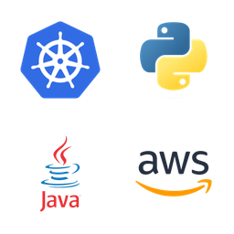

<p align="center">
  
</p>

<h1 align="center">LearnMotion</h1>

<p align="center">An interactive, animated learning app for Kubernetes, databases, system design, Git, Python, AWS, Linux, Java, CI/CD, DSA, QA, data science, ML/AI, Security, Networking, Go, Kafka, Azure, Google Cloud, Node.js, Observability & Monitoring, Ansible, Artifactory, Terraform, Helm Charts and Argo CD. Every subject has 50+ lessons, a lab, a playground, interview prep and games.</p>

## Run the app

```bash
make setup   # creates .venv and installs requirements
make run     # http://localhost:5050
make test
```

The server binds to `127.0.0.1` only. Override the port with `PORT=6000 make run`.

### Deploy to Vercel with persistent accounts

The app uses SQLite for local development and PostgreSQL when `DATABASE_URL` is set. For Vercel, connect a PostgreSQL provider from the Vercel Marketplace (for example Neon or Supabase); its connection URL should be available as `DATABASE_URL` (the app also accepts `POSTGRES_URL`). Use the provider's pooled/serverless connection URL when it offers one. The app creates its account, progress, activity, feedback, and reset-request tables on startup.

Set these variables in Vercel **Settings → Environment Variables** for Production and Preview (and Development if using `vercel dev`):

- `DATABASE_URL`: PostgreSQL connection URL from the connected storage integration.
- `AUTH_SECRET`: a stable random value of at least 32 characters. Generate one with `python3 -c "import secrets; print(secrets.token_urlsafe(32))"` and keep the same value across deployments so sessions remain valid.
- `PUBLIC_APP_URL`: optional canonical HTTPS URL for link previews.
- `ADMIN_SECRET`: optional admin panel password (16+ characters).
- `OPENROUTER_API_KEY`: optional server-side live tutor key.

Vercel detects the Flask application through the root `index.py` entrypoint. The included `vercel.json` runs a quick Python syntax compilation as the build command; it overrides any dashboard build command, so Vercel will not try to run the local development server. Deploy from the repository root. Vercel's filesystem is ephemeral, so its account data is stored in PostgreSQL; local `LEARNMOTION_DB` SQLite files are not automatically migrated. The local Kubernetes cluster and `kubectl` management API are disabled on Vercel because those controls operate on a machine-local cluster.

### Installable PWA and link previews

LearnMotion includes a web app manifest, install support in compatible browsers, an offline-cached app shell, and a 1200×630 Open Graph thumbnail for WhatsApp and other link previews. The API and lesson data still need the app server to be online. Link previews work only from a publicly reachable HTTPS URL; set `PUBLIC_APP_URL` to that canonical URL when serving through an approved public host. The included local-only server cannot be shared with other people over the internet.

### Browser mini tutor

The signed-in **Ask AI** tutor runs Qwen2.5 Instruct in the browser using WebGPU. After the first sign-in in each browser profile, it prepares the 1.5B model in a background worker and caches the weights there; if browser storage is full, it removes the incomplete download and falls back to the smaller 0.5B model. Opening chat does not start the download. A different browser or profile has its own cache and prepares the model after its first sign-in. Preparation needs internet and a WebGPU-capable browser; loading briefly uses device GPU and memory, then releases them. Ordinary questions and chapter context stay in the browser. Version and release questions use live Wikipedia search and show source links; only the subject name and question go to Wikipedia. Date questions use the device's local clock.

**Live chat** is optional and off by default. To enable it, add `OPENROUTER_API_KEY=...` to the project `.env` file, then restart the app server. The key stays server-side. Live mode sends the current lesson context and chat messages to OpenRouter's free model router; time-sensitive questions also use Wikipedia's public search API and return source links. OpenRouter's free router can be rate limited and may route to different free models. `.env` is ignored by Git; never paste the key into browser code or commit it.

## Local cluster (optional, for the Kind Playground)

Requirements: Podman (recommended) or Docker, plus `kind` and `kubectl`.

### Podman (macOS)

```bash
brew install podman kind kubectl          # skip podman if you used the podman.io installer

# kind needs a rootful machine; 4 nodes fit comfortably in 8 GB
podman machine init --rootful --cpus 4 --memory 8192
# ...or reconfigure an existing machine:
podman machine stop && podman machine set --rootful --cpus 4 --memory 8192

podman machine start                      # stuck on "Currently starting"? stop, then start again
podman info --format '{{.Host.Security.Rootless}}'   # should print false

make cluster        # 1 control-plane + 3 labelled/tainted workers + metrics-server
make cluster-full   # also installs ingress-nginx (host ports 8081/8443) and VPA
make teardown
```

The scripts detect Podman and export `KIND_EXPERIMENTAL_PROVIDER=podman` themselves. If you run `kind` by hand, add that export to `~/.zshrc`, otherwise kind looks for Docker and reports no clusters.

### Docker (macOS)

```bash
brew install --cask docker                # open Docker.app once to finish setup
brew install kind kubectl
# Docker Desktop → Settings → Resources: 4 CPUs, 8 GB memory → Apply & restart
docker info                               # daemon must answer
make cluster                              # kind uses Docker by default
```

No Docker Desktop? `brew install colima docker && colima start --cpu 4 --memory 8` works the same way.

### Choosing the runtime

Detection order: `K8S_PLAYGROUND_RUNTIME` (`podman` or `docker`), then a running Podman, then a running Docker. Example: `K8S_PLAYGROUND_RUNTIME=podman make cluster` (set it on `make run` too so the Playground status matches).

You can also create/delete the cluster from the Playground page. Every kubectl call is pinned to `--context kind-k8s-playground`.

| Node | Labels | Taint |
| --- | --- | --- |
| worker | `topology.kubernetes.io/zone=zone-a`, `disktype=ssd`, `tier=frontend` | – |
| worker2 | `topology.kubernetes.io/zone=zone-b`, `disktype=hdd`, `tier=backend` | – |
| worker3 | `topology.kubernetes.io/zone=zone-c`, `disktype=ssd`, `gpu=true` | `dedicated=gpu:NoSchedule` |

## Local-only notes

- metrics-server is patched with `--kubelet-insecure-tls`, and VPA's `vpa-up.sh` generates self-signed webhook certificates. Both are fine for a throwaway kind cluster, never for production.
- Example Secrets use placeholders; supply real values at deploy time (e.g. `--from-literal=DB_PASSWORD="$DB_PASSWORD"`).
